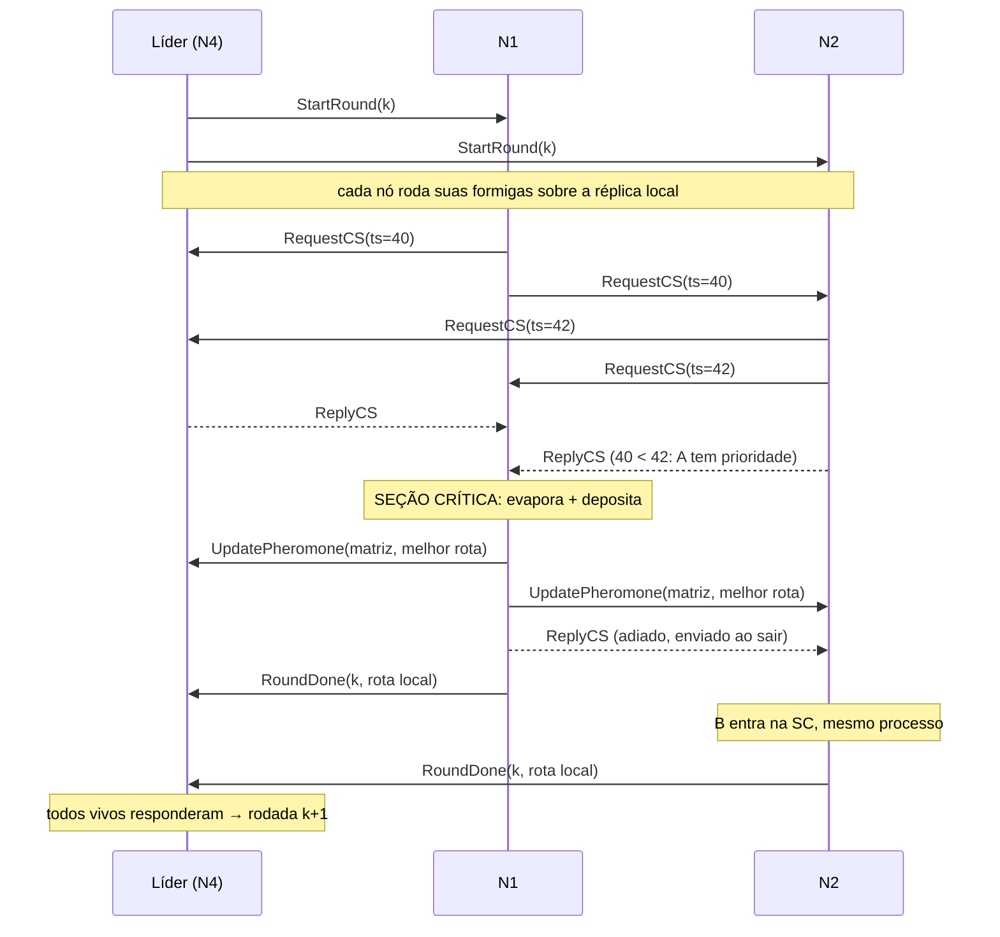

# Arquitetura — ACO distribuído para o TSP

> Documento interno do grupo: registra as decisões técnicas.
> **Não é o texto do relatório.** O enunciado desconsidera texto gerado automaticamente; o relatório deve ser escrito pelo grupo.

## 1. Problema

Caixeiro-Viajante (TSP) simétrico euclidiano resolvido por Otimização por Colônia de Formigas (ACO).
Cada nó simula um grupo de formigas; todos compartilham uma **matriz de feromônio global** replicada.

- Instância: aleatória com semente fixa (`TSP_CITIES`, `TSP_SEED`) ou arquivo TSPLIB (`TSP_FILE`).
- Linha de base: heurística do vizinho mais próximo (impressa no início).

## 2. Entidades

Todos os nós rodam **o mesmo programa** (nós simétricos). Papéis:

| Papel | Quem | Responsabilidade |
|---|---|---|
| Trabalhador | todos os nós | roda formigas locais, atualiza feromônio na seção crítica, avisa o líder |
| Líder / coordenador | 1 nó (eleito) | dispara rodadas, espera `RoundDone`, acompanha melhor global |
| Monitor | todos os não-líderes | heartbeat no líder; dispara eleição se ele cair |

## 3. Fluxo de uma rodada

## 4. Mensagens gRPC (`src/main/proto/node.proto`)

Toda mensagem carrega `Header { sender_id, lamport }`.

| RPC | Direção | Conteúdo principal | Módulo |
|---|---|---|---|
| `Election` | menor → maiores | — ; resposta `ok` | Bully |
| `Coordinator` | líder → todos | `leader_id` | Bully |
| `Heartbeat` | seguidor → líder | — | Monitor |
| `RequestCS` | nó → todos | `request_ts` (Lamport do pedido) | Ricart-Agrawala |
| `ReplyCS` | nó → solicitante | `request_ts` do pedido autorizado | Ricart-Agrawala |
| `StartRound` | líder → todos | `round` | Coordenação |
| `RoundDone` | nó → líder | `round`, `tour`, `length` | Coordenação |
| `UpdatePheromone` | dono da SC → todos | matriz n×n, melhor rota | ACO |

## 5. Requisitos da Entrega 1

### 5.1 RPC — gRPC
- Um único serviço `NodeService`; cliente em `rpc/PeerNetwork`, servidor em `rpc/NodeServiceImpl`.
- **Autenticação:** token compartilhado (`CLUSTER_TOKEN`) no header `x-cluster-token`, verificado por um `ServerInterceptor` (`rpc/ClusterAuth`). Sem ele, `UNAUTHENTICATED`. O `sender_id` também precisa estar em `PEERS`; caso contrário, `PERMISSION_DENIED`.
- Toda chamada tem *deadline*, configurável por ambiente: 500 ms (`RPC_TIMEOUT_MS`) e 2 s para o
  broadcast da matriz (`BROADCAST_TIMEOUT_MS`). Em LAN os valores são maiores — ver `docs/LAN.md`.
  Falha → peer marcado como inacessível.

### 5.2 Eleição de líder — Bully (`election/`)
- Nó envia `Election` a todos de id maior. Ninguém responde OK → vira líder e envia `Coordinator`.
- Alguém responde OK → espera `Coordinator` por 3 s (`COORDINATOR_TIMEOUT_MS`); se não chegar, recomeça.
- `Coordinator` vindo de id **menor** é contestado (nova eleição).
- Disparo: na inicialização e quando o `LeaderMonitor` perde 3 heartbeats seguidos.
- Novo líder continua da última rodada vista (`RoundWorker.lastRound()`).

### 5.3 Relógio lógico — Lamport (`clock/`)
- Envio: `tick()`; recebimento (requisição ou resposta): `max(local, remoto) + 1`.
- Usado (1) para ordenar pedidos de seção crítica e (2) nos logs (`[L=...]`).

### 5.4 Exclusão mútua — Ricart-Agrawala (`mutex/`)
- **Recurso protegido:** a matriz de feromônio global. Atualizar + propagar é a seção crítica.
- Prioridade por `(request_ts, id)`. Estados `RELEASED / WANTED / HELD`.
- `ReplyCS` é um RPC separado (assíncrono), então o handler de `RequestCS` nunca bloqueia.
- `ReplyCS` carrega o `request_ts` que autoriza. REPLY de pedido antigo é descartado. Sem isso, um REPLY
  atrasado (o pedido deu timeout, foi contado como permissão e depois o peer respondeu de verdade)
  liberaria o pedido **seguinte** antes da hora.
- Enquanto espera, o nó reavalia a cada 500 ms quem está vivo: peer que caiu deixa de ser aguardado.
  Sem isso, se o líder morre segurando REPLYs adiados, todos os outros travam no `acquire()`.
- O broadcast da matriz é **síncrono dentro da SC**: quem entra depois sempre vê a matriz mais recente.

**Por que precisa de exclusão mútua?** Cada nó faz *ler matriz → evaporar → depositar → propagar*. Sem a SC, duas atualizações concorrentes se sobrescrevem (*lost update*) e as réplicas divergem.

### 5.5 Coordenação de rodadas e subida em LAN

- O líder espera `START_DELAY_MS` e, **antes da primeira rodada**, faz um heartbeat em cada peer
  configurado, aguardando até `PEER_WAIT_MS` (`RoundCoordinator.awaitAllPeers`). Em máquinas físicas
  os nós sobem em instantes diferentes; sem a barreira, o primeiro a subir se elege e roda sozinho.
  `PEER_WAIT_MS=0` desliga a barreira (testes e compose de uma máquina).
- A barreira só vale para a rodada 1: num failover o novo líder continua de `lastRound + 1`, sem
  esperar o nó que caiu.
- O broadcast da matriz pula peers marcados como inacessíveis; sem isso, toda rodada após uma queda
  custaria `BROADCAST_TIMEOUT_MS`.

## 6. Limitações conhecidas (insumo para a Entrega 2)

- Peer inacessível no momento do `RequestCS`, ou marcado como inacessível durante a espera, conta como permissão.
  Se ele só estava lento (não morto), pode haver violação de exclusão. Detector de falhas é por timeout
  (assíncrono), então não distingue lento de morto.
- Só o líder recebe heartbeat. Um seguidor que cai só é notado quando alguém tenta falar com ele
  (no próximo `StartRound`, por exemplo). Até lá, quem espera REPLY dele fica parado (no pior caso,
  até o timeout de 30 s da rodada).
- Rodada perdida na troca de líder é pulada (o novo líder segue de `lastRound + 1`).
- Réplicas da matriz não têm versão: um nó que volta depois de cair recomeça com a matriz inicial.
- Peer pulado no broadcast por estar marcado como inacessível perde aquela atualização. Se ele só
  estava lento, sai da rodada com a réplica atrasada até a próxima atualização.
- Segurança: sem TLS, o token trafega em claro na LAN. Um membro com o token ainda consegue forjar o `sender_id` de outro membro. A solução completa é mTLS com um certificado por nó.
- Os itens de falha/réplica acima são tratamento de falhas / controle de réplicas: escopo da Entrega 2.

## 7. Testes

| Teste | O que garante |
|---|---|
| `RicartAgrawalaTest` | regra de adiamento (RELEASED/WANTED/HELD, empate por id), REPLY antigo ignorado, peer que cai |
| `RicartAgrawalaSafetyTest` | 4 nós disputando 30× cada, rede com atraso aleatório: nunca 2 na SC, sem deadlock |
| `PheromoneMatrixTest` | *lost update* sem exclusão mútua (réplicas divergem) vs. convergência com SC |
| `BullyElectionTest` | maior vivo vence, contestação de id menor |
| `ClusterIntegrationTest` | 3 nós com gRPC real: elege N3, roda as rodadas, réplicas idênticas, failover N3 → N2, token/remetente recusados |

## 8. Parâmetros (variáveis de ambiente)

| Variável | Padrão | Significado |
|---|---|---|
| `NODE_ID` | — (obrigatória) | id único; maior id vence a eleição |
| `NODE_PORT` | 50051 | porta gRPC |
| `PEERS` | "" | `id=host:porta` separados por vírgula |
| `CLUSTER_TOKEN` | — (obrigatória) | segredo compartilhado do cluster |
| `TSP_FILE` | — | arquivo TSPLIB (sobrepõe `TSP_CITIES`) |
| `TSP_CITIES` / `TSP_SEED` | 60 / 42 | instância aleatória (igual em todos os nós) |
| `ROUNDS` / `ANTS` | 30 / 40 | rodadas totais / formigas por nó por rodada |
| `ALPHA` / `BETA` / `RHO` | 1.0 / 3.0 / 0.1 | parâmetros ACO |
| `START_DELAY_MS` | 5000 | espera do líder antes da 1ª rodada |
| `RPC_TIMEOUT_MS` | 500 | deadline das chamadas curtas (LAN: 1500) |
| `BROADCAST_TIMEOUT_MS` | 2000 | deadline do broadcast da matriz (LAN: 5000) |
| `COORDINATOR_TIMEOUT_MS` | 3000 | espera pelo `COORDINATOR` na eleição (LAN: 8000) |
| `PEER_WAIT_MS` | 0 | barreira de subida antes da 1ª rodada; 0 desliga (LAN: 120000) |
