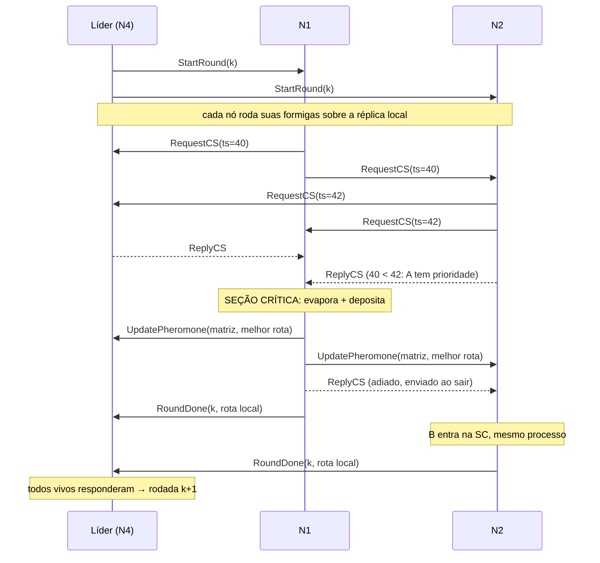

# Arquitetura — ACO distribuído para o TSP

> Documento interno do grupo: registra as decisões técnicas.
> **Não é o texto do relatório.** O enunciado desconsidera texto gerado automaticamente; o relatório deve ser escrito pelo grupo.

## 1. Problema

Caixeiro-Viajante (TSP) simétrico euclidiano resolvido por Otimização por Colônia de Formigas (ACO).
Cada nó simula um grupo de formigas; todos compartilham uma **matriz de feromônio global** replicada.

- Instância: aleatória com semente fixa (`TSP_CITIES`, `TSP_SEED`) ou arquivo TSPLIB (`TSP_FILE`).
- Linha de base: heurística do vizinho mais próximo (impressa no início).

## 2. Entidades

Todos os nós rodam **o mesmo programa** (nós simétricos). Papéis:

| Papel | Quem | Responsabilidade |
|---|---|---|
| Trabalhador | todos os nós | roda formigas locais, atualiza feromônio na seção crítica, avisa o líder |
| Líder / coordenador | 1 nó (eleito) | dispara rodadas, espera `RoundDone`, acompanha melhor global |
| Monitor | todos os não-líderes | heartbeat no líder; dispara eleição se ele cair |

## 3. Fluxo de uma rodada

## 4. Mensagens gRPC (`src/main/proto/node.proto`)

Toda mensagem carrega `Header { sender_id, lamport }`.

| RPC | Direção | Conteúdo principal | Módulo |
|---|---|---|---|
| `Election` | menor → maiores | — ; resposta `ok` | Bully |
| `Coordinator` | líder → todos | `leader_id` | Bully |
| `Heartbeat` | seguidor → líder | — | Monitor |
| `RequestCS` | nó → todos | `request_ts` (Lamport do pedido) | Ricart-Agrawala |
| `ReplyCS` | nó → solicitante | `request_ts` do pedido autorizado | Ricart-Agrawala |
| `StartRound` | líder → todos | `round` | Coordenação |
| `RoundDone` | nó → líder | `round`, `tour`, `length` | Coordenação |
| `UpdatePheromone` | dono da SC → todos | matriz n×n, melhor rota | ACO |

## 5. Requisitos da Entrega 1

### 5.1 RPC — gRPC
- Um único serviço `NodeService`; cliente em `rpc/PeerNetwork`, servidor em `rpc/NodeServiceImpl`.
- **Autenticação:** token compartilhado (`CLUSTER_TOKEN`) no header `x-cluster-token`, verificado por um `ServerInterceptor` (`rpc/ClusterAuth`). Sem ele, `UNAUTHENTICATED`. O `sender_id` também precisa estar em `PEERS`; caso contrário, `PERMISSION_DENIED`.
- *Deadlines* configuráveis por ambiente: 500 ms (`RPC_TIMEOUT_MS`), heartbeat com piso de 1 s
  (`max(1 s, RPC_TIMEOUT_MS)`) e 2 s para o broadcast da matriz (`BROADCAST_TIMEOUT_MS`). Em LAN os
  valores são maiores — ver `docs/LAN.md`. Falha → peer marcado como inacessível e re-probado
  depois de 2 s.
- Mensagens limitadas a **64 MiB** no cliente e no servidor. O padrão do gRPC (4 MiB) estouraria a
  matriz a partir de ~725 cidades; 64 MiB cobrem ~2900 cidades. Acima disso não há chunking.
- **Handshake de configuração no startup:** depois de subir o servidor, cada nó faz heartbeat nos
  peers em background por até `max(3 s, START_DELAY_MS)`. O heartbeat do handshake carrega
  `members = {self} ∪ PEERS`; o servidor compara o conjunto completo e responde
  `FAILED_PRECONDITION` se forem diferentes. `UNAUTHENTICATED` (token), `PERMISSION_DENIED`
  (remetente fora de `PEERS`) ou `FAILED_PRECONDITION` (conjunto de membros diferente) é fatal: o
  nó registra `ERRO FATAL DE CONFIGURAÇÃO` e encerra com código 2. Peer que ainda está subindo
  (`UNAVAILABLE`) é tentado de novo; se a janela acabar, o nó segue e avisa quais peers não
  responderam.

### 5.2 Eleição de líder — Bully (`election/`)
- Nó envia `Election` a todos de id maior. Ninguém responde OK → vira líder e envia `Coordinator`.
- Alguém responde OK → espera `Coordinator` por 3 s (`COORDINATOR_TIMEOUT_MS`); se não chegar, recomeça.
- `Coordinator` vindo de id **menor** é contestado (nova eleição).
- Disparo: na inicialização e quando o `LeaderMonitor` perde 5 heartbeats seguidos (timeout de 1 s;
  ~5 s no pior caso).
- O líder reanuncia `Coordinator` a cada 1 s. Isso corrige a visão de um nó que voltou ou ficou
  isolado por pouco tempo; em caso de dois líderes, o maior id vence.
- Novo líder continua da última rodada vista (`RoundWorker.lastRound()`), mas se ele estava fora
  do cluster a rodada pode retroceder (ver §6).

### 5.3 Relógio lógico — Lamport (`clock/`)
- Envio: `tick()`; recebimento (requisição ou resposta): `max(local, remoto) + 1`.
- Usado (1) para ordenar pedidos de seção crítica e (2) nos logs (`[L=...]`).

### 5.4 Exclusão mútua — Ricart-Agrawala (`mutex/`)
- **Recurso protegido:** a matriz de feromônio global. Atualizar + propagar é a seção crítica.
- Prioridade por `(request_ts, id)`. Estados `RELEASED / WANTED / HELD`.
- `ReplyCS` é um RPC separado (assíncrono), então o handler de `RequestCS` nunca bloqueia.
- `ReplyCS` carrega o `request_ts` que autoriza. REPLY de pedido antigo é descartado. Sem isso, um REPLY
  atrasado (o pedido deu timeout, foi contado como permissão e depois o peer respondeu de verdade)
  liberaria o pedido **seguinte** antes da hora.
- O pedido vai a **todos os peers configurados**; quem não respondeu recebe o REQUEST de novo a cada
  500 ms. Isso recupera um REPLY perdido e detecta o peer que caiu depois de receber o pedido (o
  reenvio falha e ele deixa de ser aguardado).
- Peer que falhou entra em **quarentena de 2 s**: `sendRequest` devolve `false` sem gastar um
  timeout por rodada, e ele é re-probado depois. Sem isso, um peer recuperado nunca voltava a ser
  contatado e ficava excluído para sempre.
- O `RoundDone` volta para **quem enviou o `StartRound`**, não para o líder eleito. Um líder que
  reiniciou e ainda não foi aceito por todos continua recebendo os resultados das suas rodadas.
- O líder usa heartbeat como *probe* dos participantes pendentes a cada 500 ms. Sem isso, um
  seguidor que morre depois do `StartRound` custava os 30 s do timeout da rodada.
- O broadcast da matriz é **síncrono dentro da SC**: quem entra depois vê a matriz mais recente.
  O coordenador é sempre contatado, mesmo em quarentena, porque é ele que precisa da matriz.

**Atenção:** uma falha de REQUEST conta como permissão. Se o peer estava apenas lento, isso viola a
exclusão mútua; ver §6. O protocolo é *best-effort* sob falhas, não tolerante a partições.

**Por que precisa de exclusão mútua?** Cada nó faz *ler matriz → evaporar → depositar → propagar*. Sem a SC, duas atualizações concorrentes se sobrescrevem (*lost update*) e as réplicas divergem.

### 5.5 Coordenação de rodadas e subida em LAN

- O líder espera `START_DELAY_MS` e, **antes da primeira rodada**, faz um heartbeat em cada peer
  configurado, aguardando até `PEER_WAIT_MS` (`RoundCoordinator.awaitAllPeers`). Em máquinas físicas
  os nós sobem em instantes diferentes; sem a barreira, o primeiro a subir se elege e roda sozinho.
  `PEER_WAIT_MS=0` desliga a barreira (testes e compose de uma máquina).
- A barreira só vale para a rodada 1: num failover o novo líder continua de `lastRound + 1`, sem
  esperar o nó que caiu.
- O broadcast da matriz pula peers marcados como inacessíveis; sem isso, toda rodada após uma queda
  custaria `BROADCAST_TIMEOUT_MS`.

## 6. Limitações conhecidas (insumo para a Entrega 2)

- **Detector de falhas é por timeout e a falha conta como permissão.** Se o peer apenas estava lento
  (GC, pico de carga), ele pode entrar na SC ao mesmo tempo que quem o considerou morto. Reproduzido:
  um REQUEST que devolve `false` com o peer vivo coloca os dois na seção crítica. Não existe detector
  perfeito em sistema assíncrono; corrigir exige membership/quórum/consenso.
- **Peer alcançável que nunca responde** (handler travado, falha assimétrica da rede) mantém o
  `acquire()` esperando indefinidamente: não há timeout global do pedido. Um timeout global trocaria
  o travamento por mais uma chance de violar a exclusão.
- **Heartbeat só do líder.** Um seguidor que cai é notado quando alguém tenta falar com ele — o probe
  em `awaitRound` encurta isso para o fim da rodada, mas até lá quem espera REPLY dele fica parado.
- **Rodada perdida na troca de líder é pulada** (o novo líder segue de `lastRound + 1`).
- **Réplicas sem versão.** A matriz é substituída inteira; um nó que voltou com a matriz inicial pode
  sobrescrever o progresso de todos. Um UPDATE atrasado (deadline estourado, mas handler executado
  depois) também pode aplicar uma matriz antiga por cima de uma nova. Precisa de epoch/versão e
  reconciliação.
- **Peer em quarentena pulado no broadcast perde aquela atualização.** O coordenador é sempre
  tentado; os demais convergem na próxima atualização. Se o peer só estava lento, fica com a réplica
  atrasada por uma rodada.
- **Estado de rodada só em memória.** Um líder que reinicia volta a `lastRound = 0`, recomeça em
  `1/ROUNDS` e retransmite a matriz inicial. O `RoundWorker` ignora rodadas repetidas (não refaz a
  SC e responde), mas o líder ainda re-executa as rodadas. Falta transferir estado/catch-up antes
  de assumir.
- **Token/PEERS divergentes = split-brain silencioso.** O handshake de startup confere token,
  remetente e o conjunto completo `{self} ∪ PEERS`; `UNAUTHENTICATED`, `PERMISSION_DENIED` e
  `FAILED_PRECONDITION` encerram o nó. Ainda não há detecção quando dois grupos não compartilham
  nenhum membro (formam clusters isolados, sem tráfego entre si) nem hash/assinatura do conjunto;
  `PEERS` continua em texto claro.
- **Heartbeat pode gerar falso positivo sob carga.** Timeout de 1 s e 5 faltas (~5 s); com milhares
  de rodadas por segundo e instância grande, o heartbeat pode atrasar e provocar eleição
  desnecessária. Não ocorreu no cenário padrão (30 rodadas). Em LAN o piso do heartbeat acompanha
  `RPC_TIMEOUT_MS` (ver §8).
- **TSPLIB limitado** a `NODE_COORD_SECTION`; `DIMENSION` não é conferido. O parser agora rejeita
  arquivo sem a seção, linha malformada e menos de 3 cidades, e para em outra `_SECTION`.
- **Tamanho da matriz.** Limite de 64 MiB por mensagem => ~2900 cidades (`n²` doubles). Acima disso
  o broadcast falha; não há chunking.
- **Sem TLS.** O token trafega em claro na LAN; um membro com o token pode forjar o `sender_id` de
  outro. A solução completa é mTLS com certificado por nó.
- **Sem persistência** de matriz, melhor rota ou rodada.
- Os itens de réplica/consenso acima continuam sendo o escopo natural da Entrega 2.

## 7. Testes

| Teste | O que garante |
|---|---|
| `RicartAgrawalaTest` | adiamento (RELEASED/WANTED/HELD, empate por id), REPLY antigo, peer que cai, REPLY perdido recuperado por reenvio, peer recuperado recontatado |
| `RicartAgrawalaSafetyTest` | 4 nós disputando 30× cada, rede com atraso aleatório: nunca 2 na SC, sem deadlock |
| `PheromoneMatrixTest` | *lost update* sem exclusão mútua (réplicas divergem) vs. convergência com SC |
| `BullyElectionTest` | maior vivo vence, contestação de id menor |
| `RoundWorkerTest` | rodada repetida não reaplica feromônio e responde ao coordenador |
| `HandshakeTest` | classifica token errado (`AUTH`), remetente fora de PEERS (`PEERS`), conjunto de membros diferente (`PEERS`) e configuração correta (`OK`) |
| `TspInstanceTest` | TSPLIB válido, outra seção (`DISPLAY_DATA_SECTION`), arquivo vazio, < 3 cidades, linha malformada, vizinho mais próximo |
| `ClusterIntegrationTest` | 3 nós com gRPC real: elege N3, rodadas, réplicas idênticas, failover do líder, queda de seguidor sem travar, token/remetente recusados |

Total: 40 testes (`mvn test` no container, ~9 s).

## 8. Parâmetros (variáveis de ambiente)

| Variável | Padrão | Significado |
|---|---|---|
| `NODE_ID` | — (obrigatória) | id único; maior id vence a eleição |
| `NODE_PORT` | 50051 | porta gRPC |
| `PEERS` | "" | `id=host:porta` separados por vírgula |
| `CLUSTER_TOKEN` | — (obrigatória) | segredo compartilhado do cluster |
| `TSP_FILE` | — | arquivo TSPLIB (sobrepõe `TSP_CITIES`) |
| `TSP_CITIES` / `TSP_SEED` | 60 / 42 | instância aleatória (igual em todos os nós) |
| `ROUNDS` / `ANTS` | 30 / 40 | rodadas totais / formigas por nó por rodada |
| `ALPHA` / `BETA` / `RHO` | 1.0 / 3.0 / 0.1 | parâmetros ACO |
| `START_DELAY_MS` | 5000 | espera do líder antes da 1ª rodada |
| `RPC_TIMEOUT_MS` | 500 | deadline das chamadas curtas (LAN: 1500); heartbeat usa `max(1000, RPC_TIMEOUT_MS)` |
| `BROADCAST_TIMEOUT_MS` | 2000 | deadline do broadcast da matriz (LAN: 5000) |
| `COORDINATOR_TIMEOUT_MS` | 3000 | espera pelo `COORDINATOR` na eleição (LAN: 8000) |
| `PEER_WAIT_MS` | 0 | barreira de subida antes da 1ª rodada; 0 desliga (LAN: 120000) |
