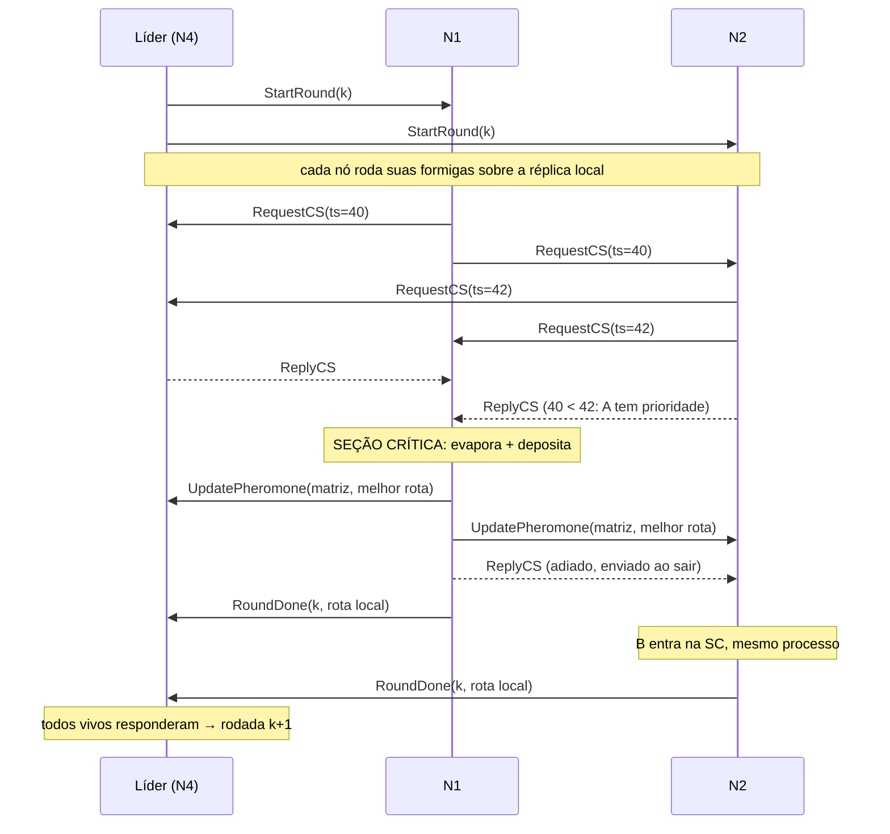

# Arquitetura — ACO distribuído para o TSP

> Documento interno do grupo: registra as decisões técnicas.
> **Não é o texto do relatório.** O enunciado desconsidera texto gerado automaticamente; o relatório deve ser escrito pelo grupo.

## 1. Problema

Caixeiro-Viajante (TSP) simétrico euclidiano resolvido por Otimização por Colônia de Formigas (ACO).
Cada nó simula um grupo de formigas; todos compartilham uma **matriz de feromônio global** replicada.

- Instância: aleatória com semente fixa (`TSP_CITIES`, `TSP_SEED`) ou arquivo TSPLIB (`TSP_FILE`).
- Linha de base: heurística do vizinho mais próximo (impressa no início).

## 2. Entidades

Todos os nós rodam **o mesmo programa** (nós simétricos). Papéis:

| Papel | Quem | Responsabilidade |
|---|---|---|
| Trabalhador | todos os nós | roda formigas locais, atualiza feromônio na seção crítica, avisa o líder |
| Líder / coordenador | 1 nó (eleito) | dispara rodadas, espera `RoundDone`, acompanha melhor global |
| Monitor | todos os não-líderes | heartbeat no líder; dispara eleição se ele cair |

## 3. Fluxo de uma rodada

## 4. Mensagens gRPC (`src/main/proto/node.proto`)

Toda mensagem carrega `Header { sender_id, lamport }`.

| RPC | Direção | Conteúdo principal | Módulo |
|---|---|---|---|
| `Election` | menor → maiores | — ; resposta `ok` | Bully |
| `Coordinator` | líder → todos | `leader_id` | Bully |
| `Heartbeat` | seguidor → líder | — | Monitor |
| `RequestCS` | nó → todos | `request_ts` (Lamport do pedido) | Ricart-Agrawala |
| `ReplyCS` | nó → solicitante | — (permissão) | Ricart-Agrawala |
| `StartRound` | líder → todos | `round` | Coordenação |
| `RoundDone` | nó → líder | `round`, `tour`, `length` | Coordenação |
| `UpdatePheromone` | dono da SC → todos | matriz n×n, melhor rota | ACO |

## 5. Requisitos da Entrega 1

### 5.1 RPC — gRPC
- Um único serviço `NodeService`; cliente em `rpc/PeerNetwork`, servidor em `rpc/NodeServiceImpl`.
- Toda chamada tem *deadline* (500 ms; 2 s para o broadcast da matriz). Falha → peer marcado como inacessível.

### 5.2 Eleição de líder — Bully (`election/`)
- Nó envia `Election` a todos de id maior. Ninguém responde OK → vira líder e envia `Coordinator`.
- Alguém responde OK → espera `Coordinator` por 3 s; se não chegar, recomeça.
- `Coordinator` vindo de id **menor** é contestado (nova eleição).
- Disparo: na inicialização e quando o `LeaderMonitor` perde 3 heartbeats seguidos.
- Novo líder continua da última rodada vista (`RoundWorker.lastRound()`).

### 5.3 Relógio lógico — Lamport (`clock/`)
- Envio: `tick()`; recebimento (requisição ou resposta): `max(local, remoto) + 1`.
- Usado (1) para ordenar pedidos de seção crítica e (2) nos logs (`[L=...]`).

### 5.4 Exclusão mútua — Ricart-Agrawala (`mutex/`)
- **Recurso protegido:** a matriz de feromônio global. Atualizar + propagar é a seção crítica.
- Prioridade por `(request_ts, id)`. Estados `RELEASED / WANTED / HELD`.
- `ReplyCS` é um RPC separado (assíncrono), então o handler de `RequestCS` nunca bloqueia.
- O broadcast da matriz é **síncrono dentro da SC**: quem entra depois sempre vê a matriz mais recente.

**Por que precisa de exclusão mútua?** Cada nó faz *ler matriz → evaporar → depositar → propagar*. Sem a SC, duas atualizações concorrentes se sobrescrevem (*lost update*) e as réplicas divergem.

## 6. Limitações conhecidas (insumo para a Entrega 2)

- Peer inacessível no momento do `RequestCS` conta como permissão. Se ele voltar no meio, pode haver violação de exclusão.
- Se o nó morrer **dentro** da SC, os pedidos adiados para ele ficam sem resposta e os outros travam.
- Rodada perdida na troca de líder é pulada (o novo líder segue de `lastRound + 1`).
- Réplicas da matriz não têm versão: um nó que volta depois de cair recomeça com a matriz inicial.
- Tudo isso é tratamento de falhas / controle de réplicas: escopo da Entrega 2.

## 7. Parâmetros (variáveis de ambiente)

| Variável | Padrão | Significado |
|---|---|---|
| `NODE_ID` | — (obrigatória) | id único; maior id vence a eleição |
| `NODE_PORT` | 50051 | porta gRPC |
| `PEERS` | "" | `id=host:porta` separados por vírgula |
| `TSP_FILE` | — | arquivo TSPLIB (sobrepõe `TSP_CITIES`) |
| `TSP_CITIES` / `TSP_SEED` | 60 / 42 | instância aleatória (igual em todos os nós) |
| `ROUNDS` / `ANTS` | 30 / 40 | rodadas totais / formigas por nó por rodada |
| `ALPHA` / `BETA` / `RHO` | 1.0 / 3.0 / 0.1 | parâmetros ACO |
| `START_DELAY_MS` | 5000 | espera do líder antes da 1ª rodada |
