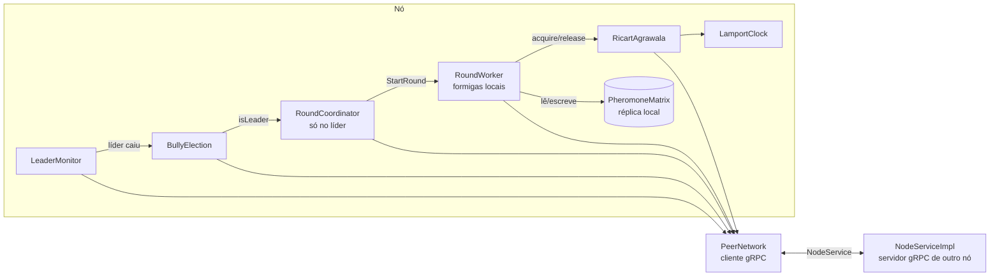

# Documentação do projeto

> Material de estudo do grupo. Não copie este texto para o relatório: o enunciado desconsidera texto gerado automaticamente.

Esta pasta explica **o que** o sistema faz, **como** cada parte funciona e **por que** cada decisão foi tomada.
O objetivo é que qualquer integrante consiga responder perguntas sobre qualquer módulo na arguição.

## Roteiro de leitura

Para quem está chegando agora, nesta ordem:

| # | Documento | O que você aprende |
|---|---|---|
| 1 | [`../README.md`](../README.md) | Como compilar, rodar e ler os logs |
| 2 | [`ARQUITETURA.md`](ARQUITETURA.md) | Visão geral: entidades, mensagens, decisões, limitações |
| 3 | [`algoritmos/aco-tsp.md`](algoritmos/aco-tsp.md) | O problema (TSP) e o algoritmo (colônia de formigas) |
| 4 | [`rodadas.md`](rodadas.md) | Como líder e trabalhadores coordenam cada rodada |
| 5 | [`algoritmos/lamport.md`](algoritmos/lamport.md) | Relógio lógico: base para ordenar eventos |
| 6 | [`algoritmos/bully.md`](algoritmos/bully.md) | Eleição de líder e detecção de falha do líder |
| 7 | [`algoritmos/ricart-agrawala.md`](algoritmos/ricart-agrawala.md) | Exclusão mútua distribuída sobre a matriz de feromônio |
| 8 | [`rede-grpc.md`](rede-grpc.md) | Contrato gRPC, cliente/servidor, autenticação |
| 9 | [`concorrencia.md`](concorrencia.md) | Threads, locks e por que nada trava |
| 10 | [`classes/`](classes/README.md) | Referência classe por classe (responsabilidade, métodos, thread-safety) |
| 11 | [`testes.md`](testes.md) | O que cada teste prova e como rodar |
| 12 | [`guia-de-execucao.md`](guia-de-execucao.md) | Roteiros de demonstração e solução de problemas |

## Por módulo (dono de cada parte)

| Pessoa | Módulo | Leia primeiro | Código |
|---|---|---|---|
| A | gRPC, infraestrutura, Docker | `rede-grpc.md`, `concorrencia.md`, `classes/rpc.md`, `classes/raiz.md` | `rpc/`, `Node.java`, `NodeMain.java`, `node.proto` |
| B | ACO / TSP e rodadas | `algoritmos/aco-tsp.md`, `rodadas.md`, `classes/aco.md`, `classes/round.md` | `aco/`, `round/` |
| C | Eleição (Bully) + monitor | `algoritmos/bully.md`, `classes/election.md` | `election/` |
| D | Lamport + Ricart-Agrawala | `algoritmos/lamport.md`, `algoritmos/ricart-agrawala.md`, `classes/mutex.md` | `clock/`, `mutex/` |

Os documentos temáticos terminam com **perguntas prováveis na arguição**. Use-as para treinar.

## Mapa do código

```
src/main/proto/node.proto             contrato gRPC (mensagens e RPCs)
src/main/java/br/pucminas/cd/aco/
  NodeMain.java                       lê variáveis de ambiente, sobe o nó, trata Ctrl+C
  Node.java                           monta todos os módulos e controla o ciclo de vida
  config/NodeConfig.java              configuração validada
  clock/LamportClock.java             relógio lógico
  election/BullyElection.java         algoritmo Bully
  election/LeaderMonitor.java         heartbeat no líder (detector de falha)
  mutex/RicartAgrawala.java           exclusão mútua distribuída
  aco/                                TSP, formigas, matriz de feromônio, melhor rota
  round/RoundCoordinator.java         papel de líder: dispara e fecha rodadas
  round/RoundWorker.java              papel de trabalhador: formigas → SC → avisa líder
  rpc/PeerNetwork.java                cliente gRPC (envia para os peers)
  rpc/NodeServiceImpl.java            servidor gRPC (recebe dos peers)
  rpc/ClusterAuth.java                autenticação por token
  util/Log.java                       log com id do nó e relógio de Lamport
src/test/java/...                     testes unitários e de integração
scripts/tp.sh  (atalho ./tp)          build, testes, cluster local, falhas, verificação, Docker, LAN
```

Cada pacote também tem um `package-info.java` com um resumo, visível na IDE ao passar o mouse.

## Como as peças se encaixam



Toda mensagem que sai passa pelo `PeerNetwork`, que carimba o relógio de Lamport.
Toda mensagem que chega passa pelo `NodeServiceImpl`, que valida o remetente, atualiza o relógio e repassa ao módulo dono.
