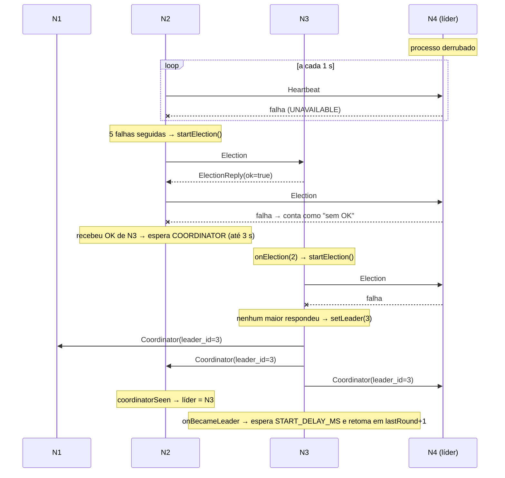

# Eleição de líder: algoritmo Bully

> Material de estudo do grupo. Não copie este texto para o relatório: o enunciado desconsidera texto gerado automaticamente.

Relacionados: [Arquitetura](../ARQUITETURA.md) · [Lamport](./lamport.md) · [Ricart-Agrawala](./ricart-agrawala.md)

Código: [`election/BullyElection.java`](../../src/main/java/br/pucminas/cd/aco/election/BullyElection.java),
[`election/LeaderMonitor.java`](../../src/main/java/br/pucminas/cd/aco/election/LeaderMonitor.java),
[`election/ElectionTransport.java`](../../src/main/java/br/pucminas/cd/aco/election/ElectionTransport.java),
[`rpc/PeerNetwork.java`](../../src/main/java/br/pucminas/cd/aco/rpc/PeerNetwork.java)

---

## 1. Problema

Todos os nós rodam o mesmo programa (nós simétricos), mas o ACO distribuído precisa de **um**
coordenador de rodadas: alguém que dispare `StartRound`, espere os `RoundDone` de todos e decida quando
a execução acabou ([`RoundCoordinator`](../../src/main/java/br/pucminas/cd/aco/round/RoundCoordinator.java)).

Fixar o coordenador na configuração ("o nó 1 é o líder") criaria um ponto único de falha: se ele cai,
o sistema para. Com eleição, os nós **concordam dinamicamente** sobre quem é o líder e escolhem outro
quando ele falha.

## 2. Intuição e definição

**Analogia:** numa sala, o "mais velho" (maior id) presente manda. Quem percebe que o chefe sumiu
pergunta só aos mais velhos que ele: "vocês estão aí?". Se algum responde, ele se cala e espera o
anúncio. Se ninguém responde, ele se proclama chefe. O mais velho vivo sempre "atropela" (bully) os
mais novos.

### Mensagens do algoritmo (Garcia-Molina, 1982)

- **ELECTION**: "estou fazendo eleição", enviada só para ids maiores.
- **OK** (resposta): "estou vivo e tenho id maior; deixa comigo".
- **COORDINATOR**: "eu sou o novo líder", enviada a todos.

### Pseudocódigo

```
ao iniciar eleição (nó p):
    para cada q com id(q) > id(p):
        envia ELECTION a q
    se nenhum respondeu OK:
        líder := p
        envia COORDINATOR(p) a todos
    senão:
        espera COORDINATOR por T
        se não chegou: recomeça a eleição

ao receber ELECTION de q (id(q) < id(p)):
    responde OK
    inicia a própria eleição (se ainda não estiver em uma)

ao receber COORDINATOR(c):
    se id(c) < id(p): contesta (inicia eleição)   # variação usada aqui
    senão: líder := c

detector de falhas:
    se o líder não responde: inicia eleição
```

Resultado: o nó **vivo de maior id** termina como líder, e todos os vivos sabem disso.

## 3. Como está implementado

### Classes

| Classe | Papel |
|---|---|
| `BullyElection` | estado da eleição (`leaderId`), regras de ELECTION/COORDINATOR, notifica quem quer saber da troca de líder |
| `LeaderMonitor` | detector de falhas: heartbeat periódico no líder |
| `ElectionTransport` | interface com o que o Bully precisa da rede (`allPeers`, `sendElection`, `broadcastCoordinator`, `heartbeat`) |
| `PeerNetwork` | implementação gRPC de `ElectionTransport` |
| `NodeServiceImpl` | lado servidor: `election(...)`, `coordinator(...)`, `heartbeat(...)` |

A interface `ElectionTransport` existe para que o algoritmo seja testável sem rede:
`BullyElectionTest` usa um `FakeTransport` em memória.

### Mapeamento regra → código

| Regra | Onde |
|---|---|
| Iniciar eleição (só uma por vez) | `BullyElection.startElection()`: `electing.compareAndSet(false, true)` e submete `runElection` a um executor de threads virtuais |
| Enviar ELECTION aos maiores, em ordem crescente | `electOrAwaitCoordinator()`: filtra `allPeers()` por `id > selfId`, chama `transport.sendElection(id)` para cada |
| Ninguém respondeu OK → vira líder | `setLeader(selfId)` + `transport.broadcastCoordinator()` |
| Alguém respondeu OK → espera COORDINATOR | `awaitCoordinator()`: `lock.wait` até `coordinatorSeen` ou `COORDINATOR_TIMEOUT_MS = 3_000` |
| Timeout sem COORDINATOR → recomeça | `runElection()`: se `retry`, loga "Nenhum COORDINATOR recebido; reiniciando eleição" e chama `startElection()` |
| Receber ELECTION | `onElection(from)`: se `from >= selfId` retorna `false`; senão inicia a própria eleição e retorna `true` (OK) |
| Receber COORDINATOR | `onCoordinator(id)`: se `id < selfId`, contesta; senão marca `coordinatorSeen`, `notifyAll` e `setLeader(id)` |
| Detectar falha do líder | `LeaderMonitor.check()` a cada 1 s; `MAX_MISSES = 5` falhas seguidas → `election.startElection()` |
| Primeira eleição | `Node.start()` chama `election.startElection()` ao subir |

### Concorrência

- `leaderId` é um `AtomicInteger` (−1 = desconhecido). `setLeader` usa `getAndSet`, então, mesmo com
  COORDINATORs chegando em paralelo, cada troca efetiva notifica os listeners uma única vez.
- `coordinatorSeen` é protegido por `lock` (monitor de `Object`), usado com `wait/notifyAll`.
- `electing` (`AtomicBoolean`) impede duas eleições simultâneas no mesmo nó. Um ELECTION recebido durante
  uma eleição em andamento só responde OK, sem criar outra.
- Os handlers gRPC **nunca bloqueiam**: `onElection` só agenda a eleição em background e responde na hora.
- `LeaderMonitor` usa um `ScheduledExecutorService` de uma thread; `misses` só é tocado por ela.
  Exceções em `check()` são capturadas porque `scheduleAtFixedRate` cancelaria a tarefa se uma escapasse.

### Quem reage à troca de líder

Em `Node`, `election.onLeaderChange(...)` registra um listener: se o novo líder é o próprio nó,
`coordinator.onBecameLeader()` inicia o laço de rodadas. O `RoundCoordinator` espera `START_DELAY_MS`
(padrão 5000 ms) para a eleição estabilizar e continua de `worker.lastRound() + 1`. O laço checa
`isLeader()` a cada rodada, então um líder destituído para sozinho.

O `RoundWorker` não consulta `leaderId`: o `StartRound` carrega quem o enviou, e o `RoundDone` volta
para esse `coordinator` (mesmo que a eleição tenha mudado no meio).

## 4. Mensagens gRPC

| RPC | Requisição | Resposta | Timeout |
|---|---|---|---|
| `Election` | `ElectionMsg { header }` | `ElectionReply { header, ok }` | 500 ms (`FAST_TIMEOUT_MS`) |
| `Coordinator` | `CoordinatorMsg { header, leader_id }` | `Ack { header }` | 500 ms, enviado em paralelo a todos |
| `Heartbeat` | `HeartbeatMsg { header }` | `Ack { header }` | 500 ms |

Em `PeerNetwork`, qualquer RPC que falha (timeout, conexão recusada) marca o peer como inacessível
(log `N3 inacessível (UNAVAILABLE)`) e `sendElection` devolve `false`, ou seja, "não respondeu OK".

### Cenário: 4 nós, N4 (líder) cai



N1 e N3 também têm `LeaderMonitor` e podem disparar eleições próprias no mesmo intervalo. Isso gera
mensagens a mais, mas o resultado converge para o mesmo líder (N3), porque a regra é determinística:
maior id vivo.

### Cenário: nó de id maior volta

Se N4 volta, ele roda `startElection()` ao subir, não encontra ninguém maior, vira líder e envia
`Coordinator(4)`. N3 aceita (4 > 3), sai de líder e o laço do `RoundCoordinator` de N3 para na próxima
checagem de `isLeader()`.

## 5. Propriedades

| Propriedade | Situação |
|---|---|
| **Segurança** (um só líder) | Garantida quando a rede não perde/atrasa mensagens além dos timeouts e o detector é preciso. Com detector impreciso (lento ≠ morto), pode haver dois líderes por um intervalo, até o COORDINATOR do maior chegar. |
| **Vivacidade** (algum líder é eleito) | Sim, enquanto houver nós vivos: quem não recebe COORDINATOR recomeça; o maior vivo sempre se declara. |
| Mensagens, melhor caso | o maior vivo detecta a falha: N−1 COORDINATORs, O(N) |
| Mensagens, pior caso | o menor detecta: cada nó dispara eleição para todos os maiores, O(N²) |
| Premissas | ids únicos e totalmente ordenados; sistema **síncrono** (timeouts significam falha); falha por parada (crash-stop) |

O Bully supõe um sistema síncrono: se uma resposta não chega no prazo, o nó está morto. Em uma LAN
isso é razoável, mas não é garantido. Ver limitações.

## 6. Decisões deste projeto

- **Bully em vez de Anel.** Topologia totalmente conectada (todos têm a lista `PEERS`), e o maior id é
  um critério simples para explicar e testar. O anel exige manter sucessores e reconstruir o anel na falha.
- **Contestação de COORDINATOR de id menor.** Se um nó menor se declarou líder sem nos ver (por exemplo,
  subimos depois dele), respondemos com uma nova eleição em vez de aceitar. Assim o invariante "líder =
  maior vivo" se restabelece sem intervenção.
- **Detector com 5 heartbeats perdidos.** Um único timeout pode ser só um pico de GC ou de rede; exigir
  5 seguidos (≈5 s no loopback; em LAN cada heartbeat tem deadline maior) reduz falsas suspeitas, ao
  custo de demorar mais para detectar a falha real.
- **Só o líder recebe heartbeat.** O detector serve para eleição; monitorar todos com todos custaria
  O(N²) mensagens por segundo. Consequência: queda de seguidor é detectada de outro jeito (ver abaixo).
- **ELECTION sequencial, COORDINATOR paralelo.** O ELECTION precisa só de "algum OK", então
  sequencial é simples. O COORDINATOR é enviado em paralelo (threads virtuais) para propagar rápido.
- **`START_DELAY_MS` antes de coordenar.** Na subida os nós aparecem em momentos diferentes; esperar
  evita disparar rodadas enquanto ainda há trocas de líder.

## 7. Limitações e evolução

- **Lento vs. morto.** O detector é por timeout; um líder lento pode ser considerado morto, gerando dois
  líderes temporários. O laço do coordenador antigo para quando recebe o COORDINATOR do novo, mas uma
  rodada pode ser disparada em duplicidade.
- **Rodada perdida na troca de líder é pulada.** O novo líder segue de `lastRound + 1`; se a rodada em
  andamento não terminou, ela não é refeita ([ARQUITETURA §6](../ARQUITETURA.md)).
- **Seguidor que cai não é monitorado.** Só é notado quando alguém tenta falar com ele.
- **Partição de rede.** Cada lado elege o próprio líder (split-brain). Resolver exige quórum (maioria),
  como em Raft.

Para a Entrega 2 (tratamento de falhas): termo/época de liderança nas mensagens (descartar `StartRound`
de líder antigo), refazer a rodada interrompida e heartbeat também entre seguidores.

## 8. Como testar e observar

- [`BullyElectionTest`](../../src/test/java/br/pucminas/cd/aco/election/BullyElectionTest.java):
  `semMaioresVivosViraLider`, `maiorVivoRespondeEAnunciaCoordenador`, `electionDeMenorRespondeOkEDisputa`.
- [`ClusterIntegrationTest`](../../src/test/java/br/pucminas/cd/aco/ClusterIntegrationTest.java):
  `elegeMaiorIdExecutaTodasAsRodadasEReplicasConvergem` (todos concordam que N3 é líder) e
  `quedaDoLiderElegeOProximoMaiorId` (fecha N3 e espera N1 e N2 concordarem em N2).
- Demo: `docker compose up`, depois `docker compose stop node4`. Procure nos logs:
  - `Líder N4 não responde há 5 heartbeats; iniciando eleição`
  - `N4 inacessível (UNAVAILABLE)`
  - `Eleição iniciada`
  - `Novo líder: N3`
  - `LÍDER: iniciando rodada ...` no log de N3.
  - Para contestação: `Nó 2 se declarou líder, mas tenho id maior; contestando`.

## 9. Perguntas prováveis na arguição

1. **Por que o nome "Bully"?** O maior id vivo sempre vence e "atropela" os menores.
2. **Para quem vai o ELECTION?** Só para ids maiores. Os menores não podem ganhar.
3. **O que acontece se alguém responde OK mas nunca manda COORDINATOR?** Após 3 s
   (`COORDINATOR_TIMEOUT_MS`) o nó recomeça a eleição.
4. **Como vocês detectam que o líder caiu?** `LeaderMonitor` manda heartbeat a cada 1 s; 5 falhas
   seguidas disparam eleição.
5. **Quantas mensagens no pior caso?** O(N²), quando o nó de menor id inicia.
6. **E se um nó maior voltar?** Ele se elege ao subir e anuncia COORDINATOR; os outros aceitam.
7. **Pode haver dois líderes?** Por um intervalo curto, se o detector errar (líder lento) ou houver
   partição. O sistema converge quando o COORDINATOR do maior chega.
8. **O que o líder faz de diferente?** Só coordena rodadas (`RoundCoordinator`); também roda formigas
   como trabalhador.
