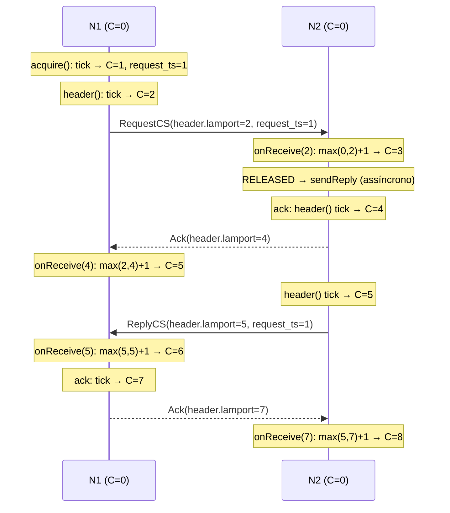

# Relógio lógico de Lamport

> Material de estudo do grupo. Não copie este texto para o relatório: o enunciado desconsidera texto gerado automaticamente.

Relacionados: [Arquitetura](../ARQUITETURA.md) · [Ricart-Agrawala](./ricart-agrawala.md) · [Bully](./bully.md)

Código: [`clock/LamportClock.java`](../../src/main/java/br/pucminas/cd/aco/clock/LamportClock.java),
[`rpc/PeerNetwork.java`](../../src/main/java/br/pucminas/cd/aco/rpc/PeerNetwork.java),
[`rpc/NodeServiceImpl.java`](../../src/main/java/br/pucminas/cd/aco/rpc/NodeServiceImpl.java)

---

## 1. Problema

Em um sistema distribuído não existe um relógio global. Cada máquina tem o próprio relógio físico,
e eles divergem (deriva, NTP desajustado, contêineres na mesma máquina com latências diferentes).
Comparar `System.currentTimeMillis()` de dois nós diferentes não diz qual evento aconteceu antes.

Neste projeto precisamos de uma noção de "antes/depois" em dois lugares:

1. **Ordenar pedidos de seção crítica.** Quando dois nós querem atualizar a matriz de feromônio ao mesmo
   tempo, o [Ricart-Agrawala](./ricart-agrawala.md) precisa decidir quem vai primeiro de forma que
   **todos os nós concordem** com a decisão. O timestamp de Lamport do pedido é o critério.
2. **Ler os logs da demonstração.** Cada linha de log mostra `[L=...]`, o valor do relógio no momento.
   Isso permite reconstruir a ordem causal dos eventos entre nós diferentes, mesmo com horários de
   parede desencontrados.

## 2. Intuição e definição

**Analogia:** imagine que cada pessoa de um grupo carrega um contador. Toda vez que faz algo, soma 1.
Toda carta que envia leva o número atual. Quem recebe uma carta com número maior que o seu "adianta"
o próprio contador para depois daquele número. Assim, uma resposta nunca tem número menor que a pergunta.

### Relação "aconteceu-antes" (→)

Lamport (1978) define `a → b` ("a aconteceu antes de b") como:

- `a` e `b` no mesmo processo e `a` ocorreu antes de `b`; **ou**
- `a` é o envio de uma mensagem e `b` é o recebimento dessa mesma mensagem; **ou**
- transitividade: `a → c` e `c → b`.

Se nem `a → b` nem `b → a`, os eventos são **concorrentes** (`a ∥ b`).

### Regras do relógio

Cada processo `i` mantém um inteiro `C_i`, inicialmente 0.

```
evento local ou envio:      C_i := C_i + 1          (a mensagem leva C_i)
recebimento com carimbo t:  C_i := max(C_i, t) + 1
```

**Condição de relógio (garantida):** `a → b  ⇒  C(a) < C(b)`.

A recíproca **não** vale: `C(a) < C(b)` não implica `a → b` (os eventos podem ser concorrentes).
Para detectar concorrência seria preciso relógio vetorial; para ordenar pedidos basta Lamport.

### Ordem total

Dois eventos de nós diferentes podem ter o mesmo `C`. Para obter uma **ordem total** usada por todos,
desempata-se pelo id do processo: `(C(a), id_a) < (C(b), id_b)` comparando lexicograficamente.
É exatamente o que o Ricart-Agrawala faz.

## 3. Como está implementado

### A classe

[`LamportClock`](../../src/main/java/br/pucminas/cd/aco/clock/LamportClock.java) tem três métodos,
todos `synchronized` (o relógio é compartilhado entre threads do servidor gRPC, executores de envio e logs):

| Método | Regra | Retorno |
|---|---|---|
| `tick()` | evento local / envio: `time = time + 1` | novo valor |
| `onReceive(remote)` | recebimento: `time = max(time, remote) + 1` | novo valor |
| `now()` | leitura sem alterar | valor atual |

Há um único `LamportClock` por nó, criado em [`Node`](../../src/main/java/br/pucminas/cd/aco/Node.java)
e injetado em `PeerNetwork`, `NodeServiceImpl`, `RicartAgrawala` e `Log`.

### Onde as regras são aplicadas

Toda mensagem do protocolo tem um `Header { sender_id, lamport }` (ver `node.proto`). A aplicação das
regras está centralizada na camada RPC, para que nenhum módulo esqueça de atualizar o relógio:

| Momento | Onde | O que acontece |
|---|---|---|
| Montar qualquer mensagem de saída | `PeerNetwork.header()` | `clock.tick()`; o valor vai em `header.lamport` |
| Servidor recebe uma requisição | `NodeServiceImpl.receive(header)` | valida remetente; `clock.onReceive(header.lamport)` |
| Servidor responde (`Ack`/`ElectionReply`) | `NodeServiceImpl.ack(...)` / `election(...)` | resposta montada com `network.header()` → novo `tick()` |
| Cliente recebe a resposta | `PeerNetwork.call(...)` | `clock.onReceive(header da resposta)` |
| Pedido de seção crítica | `RicartAgrawala.acquire()` | `ts = clock.tick()` vira o `request_ts` |
| Log | `Log.info(...)` | lê `clock.now()` e imprime `[L=...]` |

Ponto importante: **a resposta de um RPC também é uma mensagem**. No gRPC unário toda chamada tem
requisição e resposta, então o relógio é atualizado nas duas pontas, nos dois sentidos. Isso garante
que, depois de um RPC, o chamador tem relógio maior que o do servidor no momento em que este respondeu.

### `request_ts` ≠ `header.lamport`

No `CsRequest` existem dois números:

- `request_ts`: o timestamp do **evento "quero entrar na SC"**, obtido uma única vez em `acquire()`.
  É fixo durante toda a espera e é o que define a prioridade.
- `header.lamport`: o carimbo do **envio** daquela mensagem específica. Cada `sendRequest` chama
  `header()`, que faz um novo `tick()`, então ele é diferente para cada destinatário.

Se a prioridade usasse `header.lamport`, o mesmo pedido teria prioridades diferentes em cada nó, e a
ordem total quebraria.

## 4. Cenário passo a passo

Dois nós, ambos com relógio 0. N1 pede a seção crítica a N2 (só uma mensagem e sua resposta).



> Os valores exatos dependem da intercalação das threads (o `ReplyCS` é enviado por outra thread e pode
> sair antes ou depois do `Ack` do `RequestCS`). O que **sempre** vale é: cada recebimento fica com
> valor maior que o do envio correspondente.

## 5. Propriedades

| Propriedade | Situação |
|---|---|
| `a → b ⇒ C(a) < C(b)` | Garantida pelas duas regras, aplicadas em todo envio e recebimento |
| Ordem total entre nós | Com desempate por id: `(ts, id)` |
| Detectar concorrência | **Não** (precisaria de relógio vetorial) |
| Custo | Um `long` por mensagem; operação O(1) sob um lock |
| Premissas | Toda mensagem passa por `header()` e `receive()`/`call()`; ids únicos |

O relógio só cresce; nenhuma regra o faz voltar. Um `long` não estoura na prática (seriam 2⁶³ eventos).

## 6. Decisões deste projeto

- **Lamport e não relógio físico.** O enunciado aceita qualquer um dos dois; o Ricart-Agrawala precisa
  de uma ordem consistente com causalidade, e relógio físico sincronizado (Cristian/Berkeley/NTP) só
  oferece isso dentro de uma margem de erro.
- **Atualização centralizada na camada RPC.** `PeerNetwork` e `NodeServiceImpl` são os únicos pontos de
  entrada e saída de mensagens, então é impossível um módulo (Bully, rodadas, feromônio) mandar algo
  sem carimbar.
- **Tick também nas respostas.** Respostas carregam `Header` e são tratadas como mensagens. É uma
  aplicação literal das regras, e torna os logs dos dois lados coerentes.
- **`synchronized` em vez de `AtomicLong`.** `onReceive` faz "ler, comparar, escrever"; com `AtomicLong`
  seria preciso um laço de CAS (`accumulateAndGet`). O lock é simples e o custo é irrelevante perto de
  um RPC.
- **Log com `[L=...]`.** Ajuda na arguição: dá para mostrar, em logs de nós diferentes, que a entrada
  na SC segue a ordem dos `request_ts`.

## 7. Limitações e evolução

- Lamport não diz se dois eventos são concorrentes. Se a Entrega 2 precisar detectar conflito de
  versões das réplicas da matriz, um **relógio vetorial** (ou um número de versão/época) é mais adequado.
- O `sender_id` do header não é autenticado individualmente (só o token do cluster). Um membro com o
  token pode forjar timestamps de outro. Ver [ARQUITETURA §6](../ARQUITETURA.md).
- `Log` é global ao processo: com vários nós na mesma JVM (só nos testes), o `[L=...]` mostra o
  relógio do último nó criado.

## 8. Como testar e observar

- [`LamportClockTest`](../../src/test/java/br/pucminas/cd/aco/clock/LamportClockTest.java):
  `tickIncrementa` e `recebimentoUsaMaximoMaisUm` (remoto atrasado não faz o relógio voltar).
- Indiretamente: [`RicartAgrawalaSafetyTest`](../../src/test/java/br/pucminas/cd/aco/mutex/RicartAgrawalaSafetyTest.java)
  simula a camada RPC (tick no envio, `onReceive` na entrega) e depende de Lamport para a ordem.
- Nos logs: rode o `docker compose up` e compare as linhas `ENTROU na seção crítica` de nós
  diferentes. O `L` cresce em cada nó, e após receber mensagem de outro nó salta para acima do valor
  dele.

## 9. Perguntas prováveis na arguição

1. **Por que não usar o horário do sistema?** Relógios físicos de máquinas diferentes divergem; não
   garantem que causa venha antes de efeito.
2. **Qual a regra no recebimento?** `C = max(C_local, C_mensagem) + 1`.
3. **Lamport garante que `C(a) < C(b)` implica `a → b`?** Não. Só a direção contrária. Para isso
   seria relógio vetorial.
4. **Como vocês desempatam timestamps iguais?** Pelo id do nó: comparação lexicográfica `(ts, id)`.
5. **Onde o relógio é atualizado no código?** Em `PeerNetwork.header()` (envio),
   `NodeServiceImpl.receive()` (requisição recebida) e `PeerNetwork.call()` (resposta recebida).
6. **Por que existe `request_ts` além de `header.lamport`?** O pedido precisa de uma prioridade fixa e
   igual para todos os destinatários; o header muda a cada envio.
7. **Respostas atualizam o relógio?** Sim. Toda resposta gRPC carrega `Header` e passa por `onReceive`.
