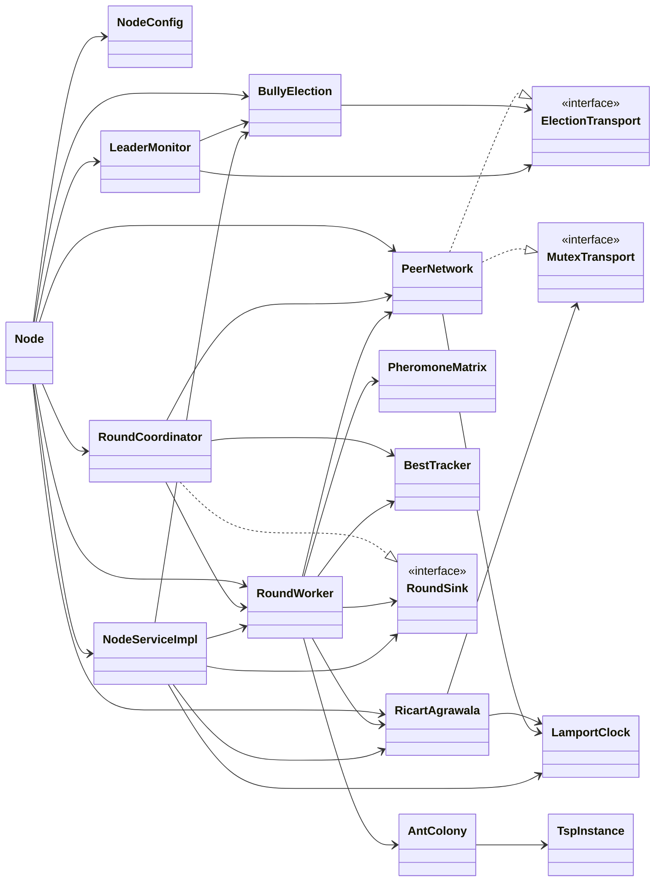

# Referência das classes

> Material de estudo do grupo. Não copie este texto para o relatório: o enunciado desconsidera texto gerado automaticamente.

Esta pasta descreve **cada classe** do código: o que faz, quem a cria e usa, que estado guarda,
de qual thread cada método é chamado e quais cuidados de concorrência ela toma.
Para a explicação dos **algoritmos** em si, veja os documentos temáticos em [`../algoritmos/`](../algoritmos/),
[`../rodadas.md`](../rodadas.md), [`../rede-grpc.md`](../rede-grpc.md) e [`../concorrencia.md`](../concorrencia.md).

## Índice

| Pacote | Classe | Tipo | Responsabilidade | Detalhes |
|---|---|---|---|---|
| `br.pucminas.cd.aco` | `NodeMain` | classe | Ponto de entrada: lê a configuração, sobe o nó e trata o desligamento | [raiz.md](raiz.md#nodemain) |
| `br.pucminas.cd.aco` | `Node` | classe | Composition root: monta todos os módulos e controla o ciclo de vida | [raiz.md](raiz.md#node) |
| `config` | `NodeConfig` | record | Configuração validada, lida de variáveis de ambiente | [config.md](config.md#nodeconfig) |
| `clock` | `LamportClock` | classe | Relógio lógico de Lamport | [clock.md](clock.md#lamportclock) |
| `election` | `BullyElection` | classe | Algoritmo Bully de eleição de líder | [election.md](election.md#bullyelection) |
| `election` | `LeaderMonitor` | classe | Detector de falha do líder por heartbeat | [election.md](election.md#leadermonitor) |
| `election` | `ElectionTransport` | interface | O que o Bully e o monitor precisam da rede | [election.md](election.md#electiontransport) |
| `mutex` | `RicartAgrawala` | classe | Exclusão mútua distribuída | [mutex.md](mutex.md#ricartagrawala) |
| `mutex` | `MutexTransport` | interface | O que o Ricart-Agrawala precisa da rede | [mutex.md](mutex.md#mutextransport) |
| `aco` | `TspInstance` | classe | Instância do TSP (matriz de distâncias) | [aco.md](aco.md#tspinstance) |
| `aco` | `AntColony` | classe | Formigas locais: constroem rotas em paralelo | [aco.md](aco.md#antcolony) |
| `aco` | `PheromoneMatrix` | classe | Réplica local da matriz de feromônio global | [aco.md](aco.md#pheromonematrix) |
| `aco` | `Tour` | record | Rota fechada + comprimento | [aco.md](aco.md#tour) |
| `aco` | `BestTracker` | classe | Melhor rota global conhecida pelo nó | [aco.md](aco.md#besttracker) |
| `round` | `RoundCoordinator` | classe | Papel de líder: dispara e fecha rodadas | [round.md](round.md#roundcoordinator) |
| `round` | `RoundWorker` | classe | Papel de trabalhador: formigas → seção crítica → avisa o líder | [round.md](round.md#roundworker) |
| `round` | `RoundSink` | interface | Destino do aviso "terminei a rodada" | [round.md](round.md#roundsink) |
| `rpc` | `PeerNetwork` | classe | Cliente gRPC: envia mensagens aos peers, mantém a visão de vivos | [rpc.md](rpc.md#peernetwork) |
| `rpc` | `NodeServiceImpl` | classe | Servidor gRPC: recebe mensagens e repassa ao módulo dono | [rpc.md](rpc.md#nodeserviceimpl) |
| `rpc` | `ClusterAuth` | classe | Autenticação por token compartilhado | [rpc.md](rpc.md#clusterauth) |
| `rpc` | `Protos` | classe | Conversões domínio ↔ protobuf | [rpc.md](rpc.md#protos) |
| `util` | `Log` | classe | Log com id do nó e relógio de Lamport | [util.md](util.md#log) |
| `grpc` (gerado) | `NodeServiceGrpc`, `Header`, `CsRequest`, … | gerado | Código gerado pelo `protoc` a partir de `node.proto` | [rpc.md](rpc.md#código-gerado-pelo-protoc) |

Testes: [testes.md](testes.md).

## Dependências principais

`Node` cria tudo. As setas tracejadas indicam implementação de interface; as cheias, uso.

## Por que as interfaces existem

`ElectionTransport`, `MutexTransport` e `RoundSink` separam os **algoritmos** da **rede**.
Em produção, `PeerNetwork` implementa as duas primeiras sobre gRPC, e `RoundCoordinator` implementa `RoundSink`.
Nos testes, fakes em memória implementam as mesmas interfaces. Assim dá para testar Bully e Ricart-Agrawala
de forma determinística, sem abrir portas nem depender de tempo de rede (ver [testes.md](testes.md)).

## Convenções usadas no código

- **Um nó por processo.** `Log` é global ao processo; em produção cada JVM roda um único nó.
- **Todo componente com threads é `AutoCloseable`.** `Node.close()` fecha todos em ordem.
- **Handlers gRPC não bloqueiam.** Toda espera acontece em threads próprias dos componentes.
- **Relógio de Lamport em toda mensagem.** Envio = `tick()` (em `PeerNetwork.header()`), recebimento = `onReceive()`.
